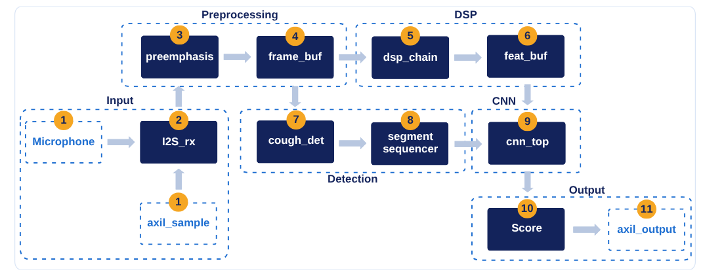

# SuaraTB

Suara batuk dapat menjadi salah satu sumber informasi untuk skrining tuberkulosis (TBC). Agar berguna, modelnya harus diuji pada data yang sesuai dan bisa dijalankan pada perangkat dengan sumber daya terbatas.

SuaraTB adalah akselerator FPGA yang menggabungkan pemrosesan audio, ekstraksi fitur log-mel, dan CNN berkuantisasi int8 untuk menghasilkan skor risiko. Hardware ditulis dalam SystemVerilog, dan model referensi di `golden/` dipakai untuk memeriksa kesesuaian hasil komputasi RTL.

Proyek ini dibuat untuk Hackathon Deeptech 2026 - Indonesia Chip Hackathon Challenge, ITB/ICDeC, dengan tema *Medical Device*.

## Cara kerja

Mikrofon I2S mengirim sampel 16 kHz ke `i2s_rx`. Sampel melewati pre-emphasis, dipotong menjadi frame yang saling tumpang tindih,
diberi jendela Hamming, lalu diubah ke spektrum dengan FFT 512 titik dan dipetakan ke 40 band mel. Logaritma diambil dengan tabel
dan hasilnya dikuantisasi ke int8, sehingga satu batuk menjadi segmen fitur berukuran 40x50. Detektor batuk membandingkan energi
tiap hop dengan derau latar yang dilacak (EMA) dan menentukan bagian audio yang diambil.

Segmen itu masuk ke CNN: tiga lapis konvolusi 3x3 dengan ReLU dan MaxPool, lalu GAP dan dua lapis FC yang menghasilkan satu logit.
Akselerator memakai skema output-stationary dengan P lane paralel, dan logitnya dibaca host lewat AXI4-Lite. Di sisi perangkat lunak host,
logit dari beberapa batuk dirata-rata dan digabung dengan lima gejala klinis (`sw/pynq/`).



Mode mikrofon memakai detektor batuk untuk memilih segmen; mode dataset memproses 50 frame pertama klip yang dikirim lewat AXI4-Lite
(`target/kv260/axi/rtl/suaratb_axil_top.sv`).

Dua keputusan desain berlaku untuk seluruh repo: setiap blok punya padanan numpy bit-exact di `golden/` yang berfungsi sebagai
spesifikasi, dan RTL dibuat vendor-neutral (tanpa IP atau primitif vendor; kode spesifik perangkat hanya di `target/`). Semua ukuran
(P, lebar data, jumlah kanal) berasal dari `golden/params.py`, sehingga konfigurasi dapat diperkecil untuk FPGA yang lebih kecil.

| Bagian | Nilai |
|---|---|
| Audio | 16 kHz, 16 bit, mikrofon I2S (INMP441), klip 0,5 s |
| Front-end | Pre-emphasis 0,97, frame 400/hop 160, Hamming, FFT 512 radix-2 (data 24 bit), mel 40 band, log2 LUT, int8 |
| Detektor batuk | Energi per hop, EMA derau, ambang 8x, tahan 300 ms |
| CNN | Conv3x3 16/32/32 + ReLU + MaxPool, GAP, FC 32->16->1; 14.496 bobot int8, 3.698.448 MAC |
| Akselerator | Output-stationary, P lane paralel (8/16/32), akumulator 24 bit, requant per layer |
| Antarmuka | I2S masuk; host AXI4-Lite (register kontrol, status, hasil, dan dataset) |

## Data

Data audio berasal dari dataset publik Kaggle "Google + CIDRZ Health AI Evaluation Zambia": rekaman batuk di tiga klinik Lusaka
dengan satu perekam dan tiga ponsel, serta metadata klinis 1.828 peserta (205 positif TB). Audio yang dapat dipasangkan dengan label
mencakup 364 peserta (60 positif). Pembagian data selalu per peserta, bukan per klip. Data, audio, fitur, bobot, dan proyek Vivado
disimpan di luar repo (`$SUARATB_DATA`, awal `/data/suaratb`).

## Hasil dan Evaluasi

Evaluasi SuaraTB punya dua pertanyaan terpisah: apakah hardware bekerja sesuai model referensi, dan apakah modelnya cukup baik untuk membantu skrining TBC.

Di sisi hardware, RTL menghasilkan keluaran yang sama dengan model referensi pada pengujian yang telah dilakukan. Desain juga dibangun sebagai sistem AXI4-Lite untuk papan Kria KV260 (XCK26) dan dijalankan di papan; hasilnya ada di bagian Hardware.

Di sisi model, hasilnya terbatas. CNN yang dilatih dari awal mencapai AUROC sekitar 0,56, belum cukup untuk membedakan kelas. Embedding audio HeAR lebih baik, tetapi tambahannya di atas fitur klinis belum meyakinkan. Dengan rata-rata 10 batuk per peserta dan lima gejala klinis, AUROC sekitar 0,80 pada 349 peserta (di papan, 100 peserta: 0,779), hampir seluruhnya berasal dari gejala. Hasil ini belum mendukung penggunaan SuaraTB sebagai alat diagnosis, dan target WHO untuk skrining belum terpenuhi.

### Hardware (Kria KV260, XCK26-SFVC784-2LV-C)

Sistem AXI4-Lite (PS, SmartConnect, MMCM, inti SuaraTB), bobot model TBC, Vivado 2026.1. Pasca-route untuk 300 MHz; 10,24 MHz hanya sintesis. Daya adalah estimasi Vivado (vectorless, confidence Low); PS8 menyumbang 2,415 W.
Sumber: laporan alat di `$SUARATB_DATA/build/kv260/`, ringkasan di `docs/vault/sintesis.md`.

300 MHz (299,997 MHz yang dicapai MMCM) adalah batas atas: clock tertinggi yang kita bangun di KV260 dengan timing terpenuhi. Slack-nya tipis, dan hanya konfigurasi ini yang sudah dijalankan di papan.
10,24 MHz (10 x 1,024 MHz; dicapai 10,24001 MHz) adalah titik kerja untuk implementasi berikutnya. Rasionya ke BCLK I2S tepat 10:1, sehingga fs tepat 16 kHz. Slack timing sangat longgar (+93,8 ns),
dan latensi CNN tetap dalam milidetik (12,0 ms untuk P32, 22,1 ms untuk P16), jauh di bawah 0,5 s pengambilan audio.

| | 10,24 MHz P16 | 10,24 MHz P32 | 300 MHz P16 | 300 MHz P32 |
|---|---|---|---|---|
| LUT | 6.688 | 8.942 | 6.326 (5,4%) | 8.541 (7,3%) |
| FF | 8.491 | 10.761 | 8.446 | 11.107 |
| BRAM36 / DSP | 12 / 17 | 11,5 / 17 | 12 / 17 | 11,5 / 17 |
| WNS | +93,8 ns (sintesis) | +93,8 ns (sintesis) | +0,127 ns | +0,070 ns |
| Daya total | - | - | 2,949 W | 2,975 W |
| Latensi CNN (siklus simulasi / clock) | 22,1 ms | 12,0 ms | 0,76 ms | 0,41 ms |

Terukur di papan (P32, sekitar 300 MHz): keluaran FPGA bit-exact terhadap golden pada 968/968 klip (100 peserta); latensi sekitar 0,4 ms per klip setelah sampel terakhir (diukur dengan Python);
mode dataset (klip lewat AXI4-Lite) dan mikrofon INMP441. Model pembanding batuk vs bukan batuk dengan arsitektur yang sama: 100/100 klip bit-exact dan 99/100 benar (`docs/vault/model.md` §10).
Latensi 10,24 MHz dan P16 dihitung dari siklus simulasi, bukan diukur di papan.
Latensi CNN = siklus simulasi (Icarus, `start` sampai `done`: P16 226.520, P32 122.872) dibagi clock; waktu yang dirasakan pengguna didominasi pengambilan 0,5 s audio.
Hasil sintesis Artix-7 XC7A35T dan pembanding Yosys ada di `docs/vault/sintesis.md`.

### Model audio

| Model | AUROC | Keterangan | Sumber |
|---|---|---|---|
| CNN dilatih dari awal | ~0,56 | Tidak dapat dibedakan dari nol permutasi | `docs/vault/model.md` §4 |
| Embedding HeAR (364 peserta, 60 positif) | 0,71 | Dalam jenis kelamin; p disesuaikan 0,002; referensi sisi host, tidak berjalan di FPGA | `docs/vault/model.md` §5d |
| Distilasi HeAR ke CNN golden | 0,654 | Guru 0,672; penurunan kuantisasi int8 0,008; RTL bit-exact; eksploratori | `docs/vault/model.md` §5e |
| CNN dari awal, kuantisasi int8 | - | Penurunan AUROC 0,001; kriteria <= 0,02 | `docs/vault/model.md` |
| Murid CNN, rata-rata 1 / 6 / 10 batuk per peserta (349 peserta, 58 positif) | 0,52 / 0,63 / 0,72 | Model yang berjalan di FPGA; lebih dari sekitar 10 klip tidak terbukti membantu | `docs/vault/model.md` §9, K-32 |

### Model klinis

| Model | AUROC | Peserta | Sumber |
|---|---|---|---|
| Gejala klinis saja | 0,77 | 1.828 (205 positif) | `docs/vault/model.md` §5b |
| Tambahan audio HeAR di atas klinis | +0,04 (CI mencakup 0) | 364 (60 positif) | `docs/vault/model.md` §5d |
| Lima gejala (lama batuk, BMI, jenis kelamin, berat turun, keringat malam) | 0,78 | 1.828 (205 positif) | K-30 |
| Gejala + rata-rata 10 batuk (fusi di host) | 0,80 (laptop, 349 peserta); 0,779 terukur di papan (100 peserta) | 349 / 100 | `docs/vault/model.md` §9 |

Standar WHO TPP triase tidak dipenuhi (`docs/vault/model.md` §5c).

### Verifikasi

| Aspek | Hasil | Sumber |
|---|---|---|
| Tes RTL | Regresi 2026-10-12: 20 tes cocotb lulus (Icarus 12, termasuk versi UART yang kini dihapus, K-34). Tes sistem sekarang `tb/sys/test_axil.py`: 3 lulus, 1 dilewati (2026-10-22) | `docs/vault/status-fase.md`, K-34 |
| Tes golden | 67 tes lulus | `docs/vault/status-fase.md` |
| Kesesuaian RTL dengan golden | Bit-exact per modul dan ujung ke ujung, mode dataset dan mikrofon | `docs/vault/verifikasi.md` |
| Konfigurasi diuji | P = 8, 16, 32; bobot acak terkalibrasi, `model_v2`, dan bobot distilasi | `docs/vault/verifikasi.md`, K-23 |

Laporan lengkap ada di `docs/result/result.md` (dan `report.pdf`).

## Demo di papan

Skrip papan di `sw/pynq/papan/` menjalankan lima mode: dataset (audio saja, dan audio + gejala), mikrofon (audio saja, dan audio + gejala), serta model verifikasi batuk vs bukan batuk. Cara pengambilan sampel
(10 klip per peserta, detektor batuk, rata-rata logit) dan hasil terukurnya ada di `docs/vault/model.md` §9 dan §10; pintasan terminal di `sw/pynq/papan/setup_papan.sh`.

## Menjalankan di papan (KV260)

1. Konsol serial dari laptop (kabel micro-USB data; keluar dengan Ctrl+A lalu Ctrl+X):

```bash
sudo picocom -b 115200 --logfile ~/kv260_console.log /dev/ttyUSB1
```

2. Model TBC (paket `~/suaratb10`; aplikasi PL `suaratb_axil` dimuat otomatis oleh skrip, tidak perlu `xmutil`):

```bash
cd ~/suaratb10
sudo python3 axil1.py clips audio100 --n 20
sudo python3 axil2.py clips fusi100 --n 50
sudo python3 mic1.py --n 10
sudo python3 mic2.py --n 10
```

`axil1` (audio saja) dan `axil2` (audio + gejala) memproses klip dataset; tanpa `--n` memakai 100 peserta. Argumen kedua (`audio100`, `fusi100`) adalah nama berkas hasil
(`.txt` dan `.csv`); beri nama berbeda tiap jalan. `mic1` dan `mic2` memakai mikrofon INMP441 (sesi 10 batuk; `mic2` menanyakan 6 gejala dulu).

3. Model batuk vs bukan batuk (paket `~/cough`; aplikasi PL `suaratb_cough` dimuat otomatis):

```bash
cd ~/cough
sudo python3 cough1.py clips uji100 --n 20
sudo python3 cough_mic.py
```

4. Pindah paket atau model: cukup `cd` ke folder paket lain lalu jalankan skripnya (ganti `suaratb6` dengan nama folder paket yang ada):

```bash
cd ~/suaratb6
```

Aplikasi PL berganti otomatis. Untuk memeriksa atau pindah manual:

```bash
sudo xmutil listapps
sudo xmutil unloadapp && sudo xmutil loadapp suaratb_cough
```

Pintasan opsional (`axil1`, `axil2`, `mic1`, `mic2`, `cough1`, `cough_mic`, `papan_status`) ada di `sw/pynq/papan/setup_papan.sh`. Isi dan hasil tiap mode: `docs/vault/model.md` §9 dan §10.

## Keterbatasan

- SuaraTB dimaksudkan untuk mendukung triase dan prioritas rujukan ke pemeriksaan lanjutan, bukan untuk mendiagnosis TBC.
- Target WHO untuk triase (sensitivitas minimal 90% dan spesifisitas minimal 70%) belum terpenuhi.
- Papan KV260 sudah dipakai (P32, sekitar 300 MHz), tetapi latensi terukur di papan hanya untuk konfigurasi itu; mikrofon INMP441 belum dikalibrasi dan akurasi di mode mikrofon belum terukur. Jenis papan di lokasi acara belum diumumkan.
- Ambang rujukan dipilih pada data yang sama dengan evaluasi (optimistis); pada sensitivitas sekitar 90%, spesifisitas gejala + audio sekitar 49%.
- Evaluasi audio memakai satu dataset dari tiga klinik dengan 364 peserta berlabel (60 positif); tidak ada klaim generalisasi.
- Syarat tambahan dataset (di luar ODbL-1.0 dari metadata Kaggle) belum dibaca, dan bobot model tidak ada di repo.

## Status

Fase 0 sampai 6 selesai, termasuk versi 150 MHz (cabang `optimized`) dan remodeling model. Fase 7 (papan KV260) sedang berjalan. Sistem AXI4-Lite P16 dan P32 sudah dibangun,
P32 terbukti bit-exact di papan, host UART dihapus (K-34), dan demo memakai skrip di `sw/pynq/`. Yang tersisa: benchmark CPU (Fase 8), build pasca-route 10,24 MHz, dan rekaman dengan INMP441.
Rincian di `docs/vault/status-fase.md`.

## Struktur repo

| Jalur | Isi |
|---|---|
| `golden/` | Spesifikasi: model numpy bit-exact, parameter beku (`params.py`), pembangkit tabel/vektor/anggaran, tes golden |
| `rtl/` | SystemVerilog vendor-neutral: audio, detektor batuk, DSP, CNN, blok bersama; sistem dan host AXI ada di `target/kv260/axi/rtl/` |
| `tb/` | Testbench cocotb per modul dan ujung ke ujung, vektor uji sintetis dari golden |
| `target/` | Satu-satunya kode spesifik perangkat: `kv260/` (sistem AXI4-Lite, block design, constraint, paket xmutil), `common/` (ROM bobot), `yosys/` dan `asic/` (sintesis pembanding, sky130) |
| `model/` | Data, pelatihan, evaluasi, embedding pralatih, distilasi, ekspor bobot int8 |
| `sw/` | Perangkat lunak host: `pynq/papan/` (skrip demo di papan), `pynq/laptop/` (menyiapkan paket klip dan fusi), `pynq/driver/` (driver PYNQ) |
| `docs/` | Konteks proyek (`vault/`), keputusan, dan laporan hasil (`result/`) |

Setiap direktori punya `README.md` sendiri.

## Dokumen

Baca berurutan: `docs/vault/status-fase.md`, `docs/vault/spesifikasi.md`, `docs/vault/keputusan.md`. Indeks: `docs/CONTEXT_INDEX.md`.
Perintah build dan tes ada di `Makefile` (`make help`) dan docstring skrip; README hanya memuat perintah untuk menjalankan demo di papan.

## Referensi

- Dataset: [Google + CIDRZ Health AI Evaluation Zambia di Kaggle](https://www.kaggle.com/datasets/googlehealthai/google-health-ai)
- Model embedding akustik: [HeAR (`google/hear-pytorch`) di Hugging Face](https://huggingface.co/google/hear-pytorch)

## Lisensi

Lihat `LICENSE`. Data Zambia CIDRZ (ODbL-1.0) dan TBscreen (CC BY 4.0) tidak didistribusikan di repo ini.

## Penggunaan AI

AI dipakai sebagai alat bantu pada proyek ini untuk:

- verifikasi dan penulisan skrip pembuatan model
- debugging proses layouting
- training embedding dengan HeAR
- debugging di seluruh bagian proyek
